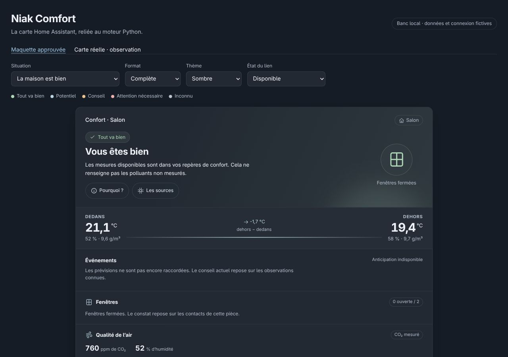

# Niak Comfort

[](https://github.com/Niakman13/niak-comfort/releases)
[](https://github.com/Niakman13/niak-comfort/actions/workflows/validate.yml)
[](https://hacs.xyz)
[](LICENSE)

[](https://github.com/sponsors/Niakman13)
[](https://www.buymeacoffee.com/frankblemont)
[](https://paypal.me/frankblemont)

Carte de confort par pièce pour Home Assistant, inspirée de Niak Weather. Elle affiche les conseils calculés par [l’intégration Niak Comfort](https://github.com/Niakman13/niak-comfort-integration), avec leurs besoins, contraintes et sources.

**Version 0.3.0-beta.3 — bêta de test.** Aucun équipement n’est commandé. Installation complète et comportement avec vos propres capteurs restent à vérifier. Home Assistant 2026.10.0 minimum pour cette première alpha.



## Fonctions

Quatre formats : mini, tuile, dépliée et complète. Comparaison dedans/dehors, fenêtres, CO₂, température, humidité et action réellement observée du chauffage. Pourquoi/sources, fenêtre complète accessible par bouton, appui long ou Shift+Entrée. Thèmes clair/sombre/HA, rubriques masquables et réordonnables, animations et verre désactivables.

Vert : tout va bien ; bleu : potentiel ; orange : conseil ; rouge : attention ; gris : inconnu. Le geste ne remplace pas le niveau : une aération observée peut rester rouge tant que le besoin mesuré persiste.

Prévisions, volets, PM2.5/COV et coordination chauffage ne sont pas raccordés. Ils restent clairement indisponibles. La carte reçoit le moteur ; elle ne recalcule pas ses conseils.

## Installation

1. Installer et configurer [l’intégration](https://github.com/Niakman13/niak-comfort-integration#installation) avec une pièce.
2. Dans HACS, ouvrir le bouton ci-dessous (ou ⋮ → **Dépôts personnalisés** : `https://github.com/Niakman13/niak-comfort`, catégorie **Tableau de bord**) et télécharger la version alpha. Afficher les versions bêta si nécessaire. Ce projet n’est pas inclus au catalogue HACS par défaut.
3. Vérifier la ressource HACS `/hacsfiles/niak-comfort/niak-comfort-card.js` en **module JavaScript**, puis recharger le navigateur.
4. Ajouter une carte Niak Comfort et choisir la pièce dans l’éditeur. Un choix automatique est possible avec une seule pièce configurée.

[](https://my.home-assistant.io/redirect/hacs_repository/?owner=Niakman13&repository=niak-comfort&category=plugin)

Installation manuelle : télécharger `niak-comfort-card.js` depuis [la release](https://github.com/Niakman13/niak-comfort/releases), le copier dans `config/www/`, puis ajouter `/local/niak-comfort-card.js?v=0.3.0-beta.3` comme module JavaScript.

```yaml
type: custom:niak-comfort-card
format: tile
```

Les capteurs et seuils se règlent dans l’intégration. L’éditeur de carte règle la présentation. Les noms d’entités ne sont pas imposés.

## Essai et développement

`npm ci` puis `npm run validate` : vérification TypeScript, 10 tests et compilation. Le bundle contient Lit et fonctionne sans téléchargement de bibliothèque externe.

Pour le banc local : `npm run build`, puis `python3 -m http.server 8766 --bind 127.0.0.1` et ouvrir `http://127.0.0.1:8766/preview/card.html`. Les vues ont été générées avec le moteur Python ; les données et la connexion sont **fictives**. Aucun accès à une installation réelle. Le script d’export est dans le dépôt de l’intégration.

Les contrôles navigateur locaux couvrent les formats, thèmes, petits écrans, sources, gestes et retrait des réponses invalides. Ils ne certifient pas toutes les versions HA ni une conformité d’accessibilité exhaustive.

## Les trois piliers

Weather fournira observations et prévisions en lecture seule. Comfort évalue besoins et possibilités. Le futur chauffage conservera la responsabilité des commandes autorisées. Ces raccordements restent à développer ; aucune proposition de pause n’est envoyée dans cette alpha.

Licence MIT — Niakman13. Les notices de Lit sont dans `licenses/`.

La configuration des sources se fait dans **Niak Confort → Mon logement**, dans la barre latérale Home Assistant. Le bouton **Configurer cette pièce** de la carte ouvre directement la pièce concernée pour les administrateurs.
